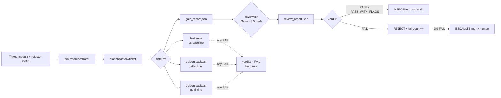

# Finance Software Factory — hackathon demo

**Pitch (5 lines):** Agents refactor finance code; nothing merges unless results are
provably unchanged. A coded gate re-runs golden backtests (exact 1e-9 diff) plus the
unit-test suite (compared against a recorded pre-existing-failure baseline), then a
Gemini reviewer votes — but any gate FAIL forces FAIL regardless of the model's opinion.
Three consecutive FAILs on a ticket escalate to a human. Fights AI slop: plausibly-named
"refactors" that subtly change numbers die at the gate with evidence.

## Architecture



## Run

```bash
cd /data/finance/factory-demo-20261113
/data/finance/.venv-embed/bin/python factory/run.py --scenario a   # good refactor -> MERGED
/data/finance/.venv-embed/bin/python factory/run.py --scenario b   # planted off-by-one -> REJECTED
```

Keys: `~/.config/gemini.key` (600) read at runtime, never printed/committed;
redacted from all error paths in `factory/review.py`.

## Demo outputs (as run 2026-11-13)

**Scenario (a) — good refactor → MERGED** (`factory/evidence/run_log.txt`):
- patch `factory/refactor_qs.diff` (dead O(n²) `rest` computation removed,
  `week_ends()` helper extracted, `datetime` import moved to top) applied
  and committed on ticket branch.
- Gate: test_suite PASS (6 failing vs 7 in the pre-existing baseline — one
  flaky baseline test happened to heal, reported as `healed`); golden_attention
  PASS; golden_qs_timing PASS (exact match, 1e-9).
- Gemini: **PASS**, 0 findings.
- Merge: real merge commit `687c2a6` "Factory merge: T-101 (gate PASS, Gemini PASS)";
  post-merge main verified to contain the refactor
  (`factory/evidence/main_qs_timing_post_merge.py`).

**Scenario (b) — planted bad refactor → REJECTED** (`factory/evidence/run_log_scenario_b.txt`):
- patch `factory/planted_bug.diff` changes `min(l[i-6:i-1])` → `min(l[i-5:i-1])`
  (off-by-one in the failed-bounce rolling-low window; commit message reads
  plausibly: "simplify failed-bounce lookback window").
- Unit tests: PASS (nothing covers this script — this is the point).
- Gate: **FAIL** — `golden_qs_timing: 6 diffs; first: $.failed_bounce.cagr: -6.5 vs -7.5`
  (`factory/evidence/gate_report_scenario_b.json`).
- Gemini: **FAIL** — independently flagged "[critical] Changing the slice index
  alters the lookback window size for lo5, introducing a logic change that fails
  golden…"; plus the hard-rule finding (gate failure forces FAIL)
  (`factory/evidence/review_report_scenario_b.json`).
- Rejected; not merged; `T-102: 1` recorded in fail_counts.

## Files

| path | what |
|---|---|
| `factory/gate.py` | coded gate → `factory/gate_report.json` (PASS/FAIL + evidence per check) |
| `factory/review.py` | Gemini reviewer → `factory/review_report.json` (strict JSON) |
| `factory/run.py` | orchestrator (one command per scenario) |
| `golden/attention.json`, `golden/qs_timing.json`, `golden/SHA256SUMS` | golden outputs + hashes |
| `golden/tests_baseline.json` | 7 pre-existing test failures (gate catches NEW breakage) |
| `factory/refactor_qs.diff`, `factory/planted_bug.diff` | the two tickets |
| `factory/run_log.txt`, `factory/gate_run_a.log` | run evidence |
| `docs/original_README.md` | the finance desk's own README (preserved) |

## Notes / limitations

- Golden determinism: both goldens depend on committed data files
  (`raw/price/*.json`, `brightdata-pilot/parsed/attention.parquet`) — committed here
  so reruns are byte-stable.
- The reviewer model is `gemini-3.5-flash` (2.5-pro returns 404 "no longer available
  to new users"; 3.1-pro-preview 429-quota for this key).
- ESCALATE path is implemented (`factory/fail_counts.json` ≥3 → `ESCALATE.md`) but not
  triggered in the scripted demos (would require 3 runs of scenario b).
- Scenario (a) mutates demo main (merges the refactor); rerunning scenario (a) after a
  merge needs `git reset --hard <pre-demo sha>` or the patch will not apply. Scenario
  (b) is rerunnable as-is (its branch is rebuilt from main each run; the planted diff
  targets the pre-refactor file, so run it before (a) or reset first).
